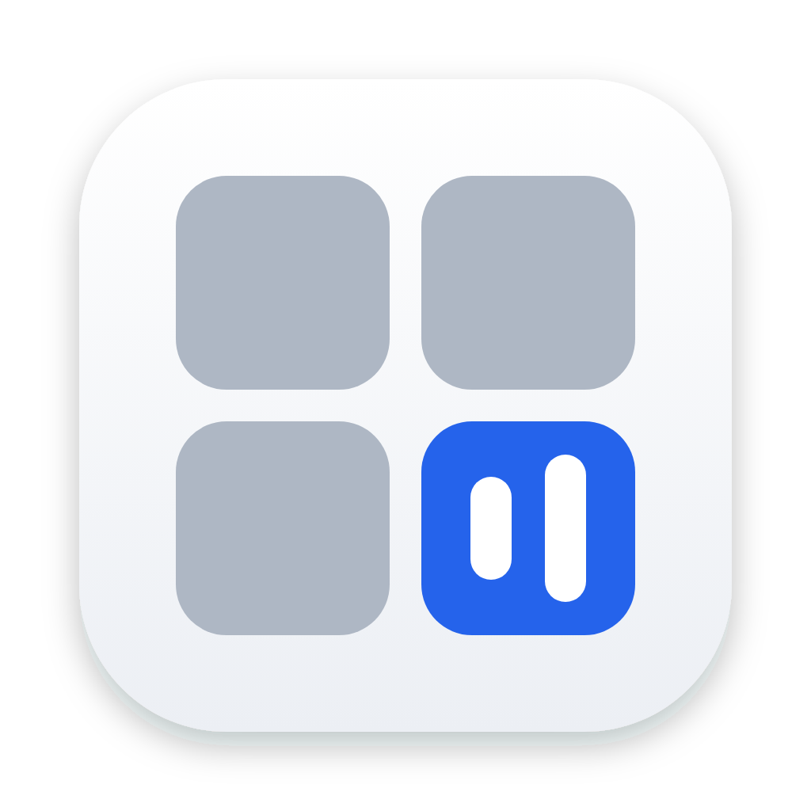
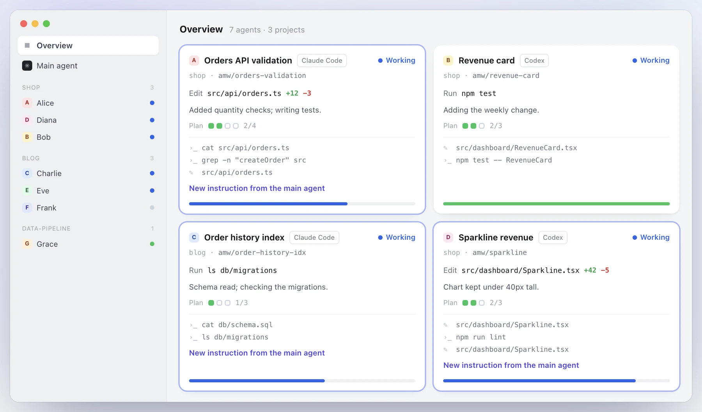
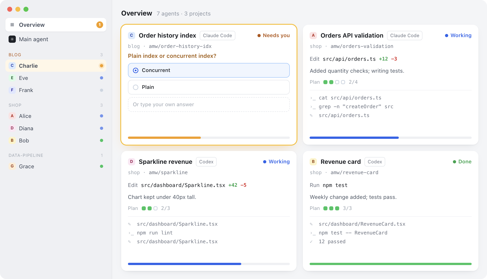
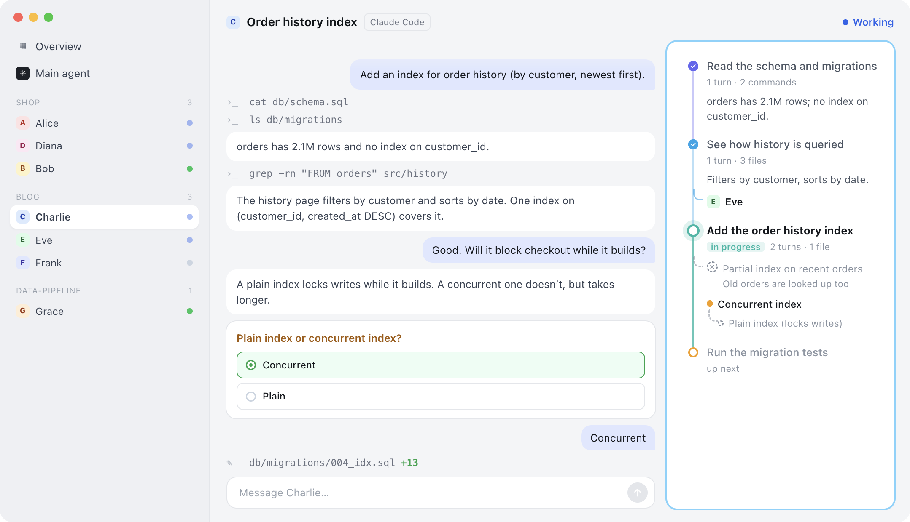

<p align="center">
  
</p>

<h1 align="center">Agent Workspace</h1>

<p align="center">
  <b>English</b> · <a href="README.zh-CN.md">简体中文</a>
</p>

<p align="center">
  <b>Stop juggling tabs and terminals. Run a meeting with your agents.</b><br>
  A desktop app for managing parallel agents, side by side.
</p>

<p align="center">
  <a href="https://github.com/Flitternie/agent-workspace/releases/latest"></a>
  
  
  <a href="LICENSE"></a>
</p>

<p align="center">
  <a href="https://github.com/Flitternie/agent-workspace/releases/latest"><b>Download</b></a> ·
  <a href="#get-started">Get started</a> ·
  <a href="#faq">FAQ</a> ·
  <a href="app/README.md">Developer docs</a>
</p>

<p align="center">
  
</p>

If you run several Claude Code or Codex sessions at once, you know how it goes: a dozen terminals, an agent that has been waiting on you for twenty minutes, and no easy way to see what each one already tried. Agent Workspace puts them all in one window.

## Overview

**See every agent at once.**

- Each agent is a card: what it did, what it is doing, what it needs from you.
- Questions and permission requests stay on the card, with the proposed change, until you answer.
- Reply, approve or redirect from the card. Each agent works in its own git worktree.
- Cards and the sidebar sort themselves: whatever waits on you comes first, then what is working, then what is done.

<p align="center">
  
</p>

## Main agent

**Tell one agent. It tells the rest.**

<p align="center">
  
</p>

- Tell the main agent what you need; it briefs the right agents, starts new ones, or forks one to try another approach.
- Ask "how is everyone doing?" and get an answer from what each agent is doing now.
- Keep the mic open like a call: "Alice, add a regression test" goes straight to Alice, everything else to the main agent. Speech recognition can run entirely on device.
- It coordinates, and never edits code or approves a permission request on its own.

## Work Map

**Read back a long session without scrolling through it.**

<p align="center">
  
</p>

- **Session Map:** an agent's conversation as a tree of tasks, with outcomes, the decisions along the way and the forks that tried something else. Click a task to jump there.
- **Team Map:** one lane per agent beside the main agent: what went to whom, and where each stands. Long conversations turn into chapters, and the map follows.

## Memory

**Teach one agent. All of them know.**

- Click **Remember** on something you said. It is turned into a note about how you want things done, not a copy of your words, for this project or for everything.
- The note reaches every agent: Claude Code and Codex, on this machine and on your servers. Running agents get it with their next message.
- Your own memory files stay yours. The app writes only its own marked section, after a backup.

## Also built in

- **Side column:** preview a file, see this turn's changes, ask a side question with `/btw`, or check what the agent remembers, all beside the conversation
- **Fork:** branch an agent from before any earlier message, into a new worktree
- **Remote machines:** run agents on your servers over SSH, with the CLIs and logins there
- **Images and files:** paste a screenshot, `@`-mention a file, or drop one in
- **`!` commands:** run a command in the agent's folder; it sees the output
- **Model per agent:** switch an agent's model from its next turn
- **Pick up a session:** continue any existing Claude Code or Codex session

Every feature works the same with both CLIs:

| | Claude Code | Codex |
|---|:---:|:---:|
| Overview cards, permissions on the card | ✓ | ✓ |
| Runs the main agent | ✓ | ✓ |
| Session Map and Team Map | ✓ | ✓ |
| Fork | ✓ | ✓ |
| Side questions | ✓ | ✓ |
| Images and `@` files | ✓ | ✓ |
| Agents on SSH hosts | ✓ | ✓ |
| Continue existing sessions | ✓ | ✓ |

## Get started

1. **Install Claude Code and/or Codex** and sign in. Agent Workspace uses them, with your existing plan: no extra account or API key.
2. **Download** the [latest release](https://github.com/Flitternie/agent-workspace/releases/latest): the `.dmg` for macOS (Apple Silicon), or the `.exe` for Windows (x64, experimental).
3. **Open it**, add a project folder and start an agent, or just tell the main agent what you need.

> [!NOTE]
> The macOS app is not notarized yet. The first time, right-click it in Applications and choose **Open**. On Windows, if SmartScreen warns, choose **More info → Run anyway**.

## FAQ

<details>
<summary><b>Do I need another subscription or an API key?</b></summary>

No. Agents run through the Claude Code and Codex you already have, on your existing plan. An OpenAI key is only needed if you choose OpenAI for speech recognition.
</details>

<details>
<summary><b>How is this different from opening several terminals?</b></summary>

You see every agent on one screen, and whichever one is waiting on you moves to the top. You can give one instruction to the main agent instead of repeating it in each terminal, and the Work Map shows what each agent did without scrolling back through its conversation.
</details>

<details>
<summary><b>Does my code or conversation go through your servers?</b></summary>

No. There is no server of ours. Agents run through the `claude` and `codex` CLIs on your machine, or on your own server over SSH, and the workspace data stays on your disk.
</details>

<details>
<summary><b>Can it approve things on my behalf?</b></summary>

No. Each agent keeps its CLI's own permission mode, which you can set per agent, and nothing bypasses it. The main agent cannot approve another agent's request either.
</details>

<details>
<summary><b>Will it change my CLAUDE.md or AGENTS.md?</b></summary>

Only its own marked section, and only after a backup. What you wrote yourself is never changed. You can turn shared memory off in Settings.
</details>

<details>
<summary><b>Does audio leave my computer?</b></summary>

Only if you choose OpenAI for speech recognition. With an on-device model (SenseVoice, Whisper or Paraformer), audio stays on your machine. Voice is optional.
</details>

<details>
<summary><b>Does it work on Windows and Linux?</b></summary>

macOS on Apple Silicon is the main platform. There is a Windows x64 build, still experimental. There is no Linux build yet, though agents can run on Linux servers over SSH.
</details>

## Development

<details>
<summary><b>Build from source</b></summary>

Requirements: macOS (Apple Silicon tested), Node 22, and the `claude` and/or `codex` CLI.

```bash
npm run setup   # installs into app/node_modules
npm start       # the workspace
npm run demo    # a separate demo with mock agents
```

Scripts, tests, the code layout and releasing are in [app/README.md](app/README.md).

</details>

## License

[AGPL-3.0](LICENSE). Issues and pull requests are welcome.
