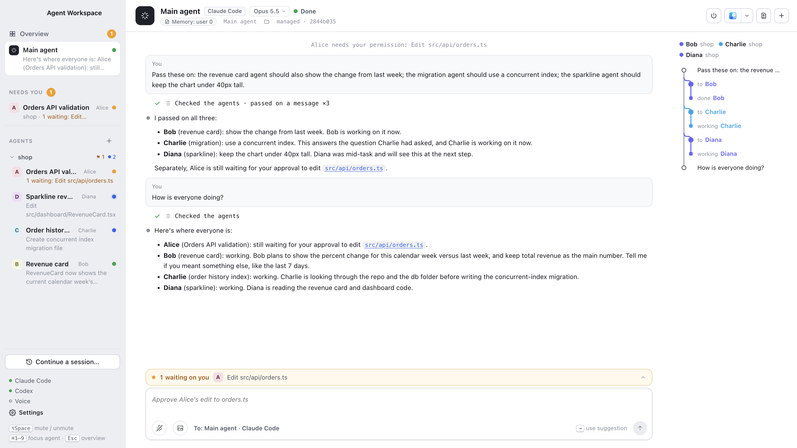

<p align="center">
  
</p>

<h1 align="center">Agent Workspace</h1>

<p align="center">
  <b>Run a team of coding agents like a meeting.</b><br>
  Claude Code and Codex side by side, one main agent to talk to, and a map of everything they did.
</p>

<p align="center">
  <a href="https://github.com/Flitternie/agent-workspace/releases/latest"></a>
  
  
  <a href="LICENSE"></a>
</p>

<p align="center">
  <a href="https://github.com/Flitternie/agent-workspace/releases/latest">Download</a> ·
  <a href="README.zh-CN.md">中文</a> ·
  <a href="app/README.md">Docs for developers</a>
</p>

<p align="center">
  
</p>

You already run several Claude Code and Codex sessions at once. The hard part is no longer the agents: it is keeping track of who is doing what, who is waiting on you, and what each of them tried. Agent Workspace puts them all in one room, and lets you run the room by talking to it.

## The Overview: every agent at a glance

Each agent is a card that reports what it did and what it needs from you.

- **Nothing slips by.** A question or a permission request stays on its card, with the proposed change, until you answer, however long you spend elsewhere.
- **Reply where you are.** Answer, approve or send the next instruction from the card, without opening the agent.
- **Both CLIs, side by side.** Claude Code and Codex agents work in the same project, each in its own git worktree.

## The main agent: one conversation for the whole team

<p align="center">
  
</p>

Unless you pick an agent, you talk to the main agent: your own Claude Code or Codex, given the whole team.

- **It passes work on.** "Have the revenue card show last week's change, and tell the migration agent to use a concurrent index" goes to the right agents, as clear instructions.
- **It keeps track.** Ask "how is everyone doing?" and it answers from what each agent is doing now. It starts new agents, or forks one to try another approach.
- **It never takes over.** The main agent does not edit code, and cannot approve another agent's permission request on its own.
- **Talk to it.** The microphone can stay open like a call. "Alice, add a regression test" or "小张，迁移先停一下" goes straight to that agent; anything else goes to the main agent. Speech recognition can run entirely on your Mac.

## Work Map: see how the work unfolded

<p align="center">
  
</p>

Long agent sessions are hard to read back. Work Map draws them.

- **Session Map:** each agent's conversation as a tree of tasks, each with its outcome, the decisions made along the way, and the forks that branched off to try something else. Click a task to jump there.
- **Team Map:** beside the main agent, one coloured lane per agent: what was handed to whom, and how each is doing now. Long conversations are split into chapters, and the map follows.

## And also

- **Side questions (/btw):** ask an agent about its work while it keeps going. The answer opens beside the conversation, never interrupts the agent and never becomes part of its context. Works with Claude Code and Codex.
- **Fork** an agent from before any of your earlier messages, Claude Code or Codex, into its own worktree.
- **Remote machines:** agents can run on your servers over SSH, with the CLIs and logins there.
- **Images and files:** paste a screenshot, `@`-mention a file, or drop one in. The main agent passes them on.
- **Shared memory** across Claude Code and Codex, and across your machines, without overwriting your own memory files.
- **Continue** any existing Claude Code or Codex session, from any folder.
- **English and 中文** interface.

## Get started

1. **Download** the [latest release](https://github.com/Flitternie/agent-workspace/releases/latest):
   - **macOS (Apple Silicon):** open the `.dmg` and drag Agent Workspace to Applications. The app is not notarized yet, so the first time, right-click it and choose **Open**.
   - **Windows (x64, experimental):** run the `.exe`. If SmartScreen warns, choose **More info → Run anyway**.
2. **Have Claude Code and/or Codex installed and signed in.** The app uses them, with your existing logins and plans: no extra account or API key.
3. **Open the app**, add a project folder and start an agent. Or just tell the main agent what you need.

## How it works, and your privacy

- Agents run through the `claude` and `codex` CLIs on your machine (or on your server, over SSH). The app puts no server of its own in between.
- Permissions follow each CLI's own modes and are never bypassed; you can set them per agent.
- Your workspace stays on your machine, and the app does not change your CLI settings. Shared memory, while it is on, writes only to its own marked section of your memory files, after a backup.
- Speech recognition uses OpenAI with your key, or an on-device model (SenseVoice, Whisper, Paraformer) that sends no audio anywhere.

## Build from source

Requirements: macOS (Apple Silicon tested), Node 22, and the `claude` and/or `codex` CLI.

```bash
npm run setup   # installs into app/node_modules
npm start       # the workspace
npm run demo    # a separate demo with mock agents
```

See [app/README.md](app/README.md) for scripts, tests, the code layout and releases.

## License

[AGPL-3.0](LICENSE)
