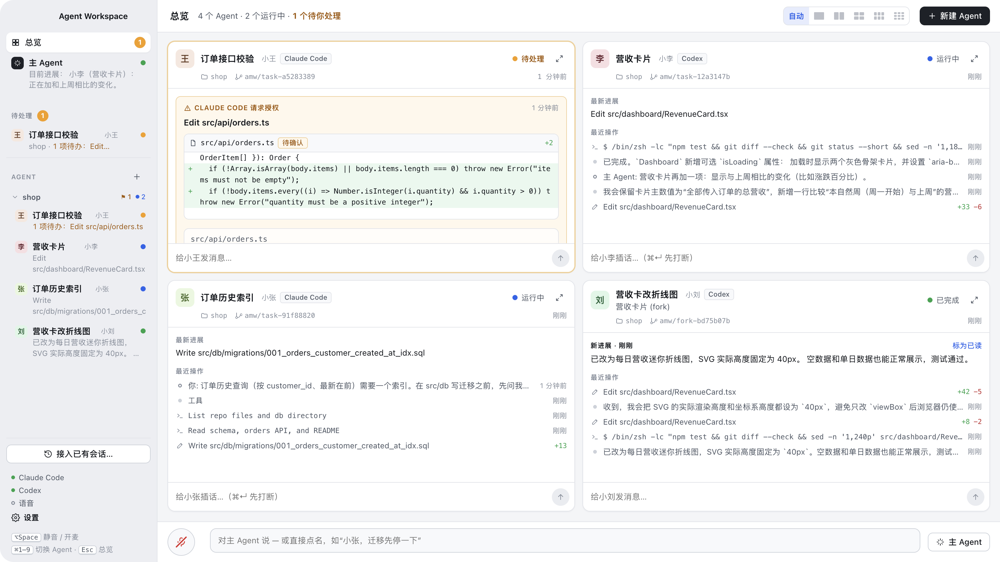

<p align="center">
  
</p>

<h1 align="center">Agent Workspace</h1>

<p align="center">
  <b>像开会一样，带一支编程 Agent 团队。</b><br>
  Claude Code 和 Codex 并肩工作，一个主 Agent 统一调度，一张地图看清所有进展。
</p>

<p align="center">
  <a href="https://github.com/Flitternie/agent-workspace/releases/latest"></a>
  
  
  <a href="LICENSE"></a>
</p>

<p align="center">
  <a href="https://github.com/Flitternie/agent-workspace/releases/latest">下载</a> ·
  <a href="README.md">English</a> ·
  <a href="app/README.md">开发文档</a>
</p>

<p align="center">
  
</p>

你可能已经同时开着好几个 Claude Code 和 Codex。难的早已不是 Agent 本身，而是记住谁在做什么、谁在等你回复、每个都试过什么。Agent Workspace 把它们放进同一个会议室，你开口说话就能指挥全场。

## 总览：所有 Agent 一目了然

每个 Agent 是一张卡片，汇报它做了什么、需要你做什么。

- **不会漏掉任何事。** 提问和权限请求会连同改动内容一起留在卡片上，直到你处理，不管你在别处待了多久。
- **就地回复。** 在卡片上直接回答、批准或下一步指令，不用点进去。
- **两种 CLI 并肩工作。** Claude Code 和 Codex 可以在同一个项目里一起干活，各自有独立的 git worktree。

## 主 Agent：一个对话管住整个团队

<p align="center">
  
</p>

不点名时，你都在和主 Agent 说话。它就是你自己的 Claude Code 或 Codex，只是能看到整个团队。

- **替你分派。** 「让营收卡片那个 agent 再显示和上周的对比，再告诉索引那个用并发索引」，它会整理成清楚的指令，分别发给对应的 Agent。
- **替你盯进度。** 问一句「大家进展怎么样？」，它按每个 Agent 当下的状态回答；还能新建 Agent，或者 fork 一个出来试另一种方案。
- **从不越权。** 主 Agent 不改代码，也不能自己批准别的 Agent 的权限请求。
- **开口就行。** 麦克风可以像通话一样常开。「小张，迁移先停一下」「Alice, add a regression test」会直接发给点名的 Agent，其余的交给主 Agent。语音识别可以完全在本机完成。

## 工作地图（Work Map）：看清工作是怎么推进的

<p align="center">
  
</p>

Agent 的长对话很难回头读。工作地图把它画出来。

- **会话地图（Session Map）：** 每个 Agent 的对话画成一棵任务树，每个任务有结果、过程中做过的决定，以及 fork 出去尝试其他方案的分支。点一下任务就跳到对应位置。
- **团队地图（Team Map）：** 在主 Agent 旁边，每个 Agent 一条彩色的线：什么事交给了谁、现在进展如何。对话太长时会自动分章，地图也跟着更新。

## 还有这些

- **旁支提问（/btw）：** agent 干活时随时问它关于这份工作的问题，它不用停下来。回答显示在对话旁边，不会打断它，也不会写进它的上下文。Claude Code 和 Codex 都支持。
- **Fork：** 从你之前任意一条消息之前，把 Agent 分叉到新的 worktree，Claude Code 和 Codex 都支持。
- **远端服务器：** Agent 可以通过 SSH 跑在你的服务器上，用服务器上的 CLI 和登录。
- **图片和文件：** 粘贴截图、用 `@` 引用文件，或者直接拖进来；主 Agent 也会帮你转交。
- **共享记忆：** 在 Claude Code 和 Codex 之间、在你的多台机器之间同步，不会覆盖你原有的记忆文件。
- **接上已有会话：** 在任意文件夹里继续之前的 Claude Code 或 Codex 会话。
- **中文和英文界面。**

## 开始使用

1. **下载**[最新版本](https://github.com/Flitternie/agent-workspace/releases/latest)：
   - **macOS（Apple Silicon）：** 打开 `.dmg`，把 Agent Workspace 拖进「应用程序」。应用还没有经过 Apple 公证，第一次打开请右键点击，选择「打开」。
   - **Windows（x64，实验性）：** 运行 `.exe`。如果 SmartScreen 提示，选择「更多信息 → 仍要运行」。
2. **装好并登录 Claude Code 和/或 Codex。** 应用直接用它们，沿用你现有的登录和套餐，不需要额外的账号或 API key。
3. **打开应用**，添加一个项目文件夹，新建 Agent；或者直接告诉主 Agent 你要做什么。

## 工作方式与隐私

- Agent 通过你机器上（或通过 SSH 在你服务器上）的 `claude` 和 `codex` CLI 运行，中间没有任何我们自己的服务器。
- 权限遵循各 CLI 自己的模式，从不绕过，也可以给每个 Agent 单独设置。
- 工作区数据留在你的机器上，应用不改你的 CLI 设置。共享记忆开启时，只会在先备份后，写入你记忆文件里它自己标记的那一段。
- 语音识别可以用 OpenAI（需要你的 key），也可以用本机模型（SenseVoice、Whisper、Paraformer），音频不会发送到任何地方。

## 从源码运行

需要：macOS（已在 Apple Silicon 上测试）、Node 22，以及 `claude` 和/或 `codex` CLI。

```bash
npm run setup   # 依赖装在 app/node_modules
npm start       # 启动工作区
npm run demo    # 独立的演示，用模拟 Agent
```

脚本、测试、代码结构和发版流程见 [app/README.md](app/README.md)。

## 许可证

[AGPL-3.0](LICENSE)
