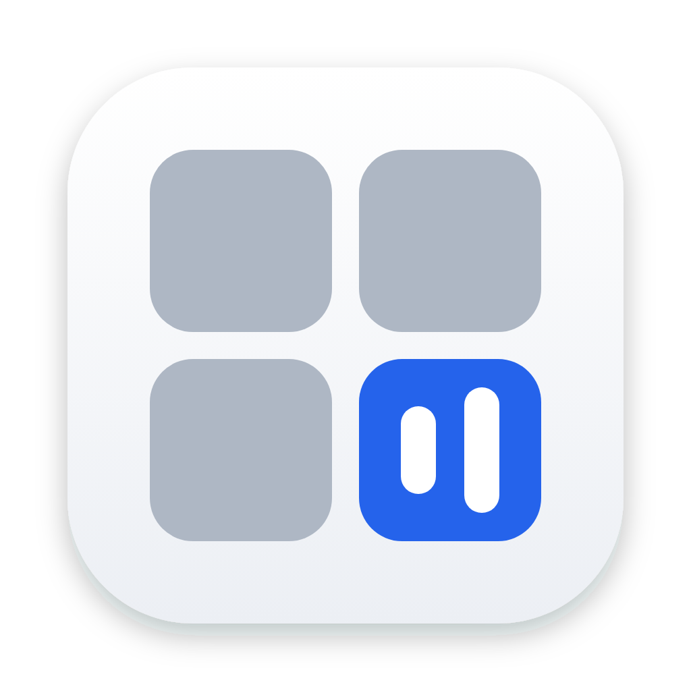
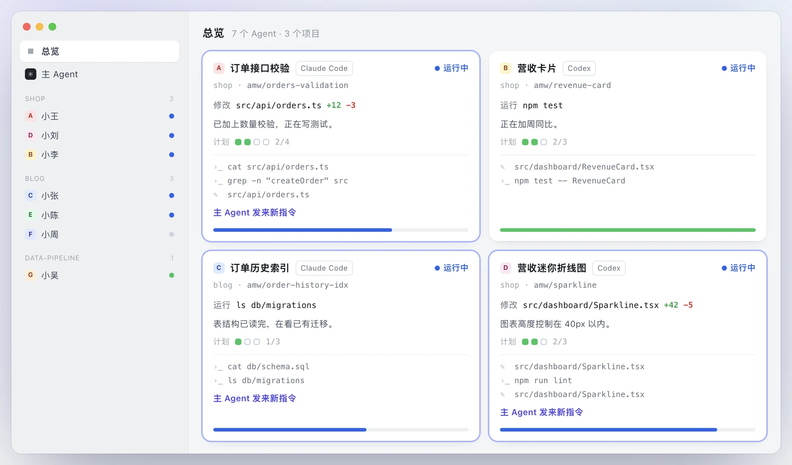
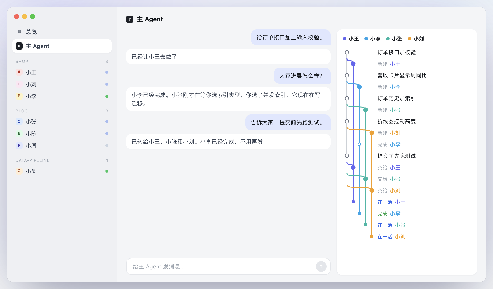

<p align="center">
  
</p>

<h1 align="center">Agent Workspace</h1>

<p align="center">
  <a href="README.md">English</a> · <b>简体中文</b>
</p>

<p align="center">
  <b>多开不乱，一眼看全。</b><br>
  一个桌面应用，把并行的多个 Agent 放在一起管理。
</p>

<p align="center">
  <a href="https://github.com/Flitternie/agent-workspace/releases/latest"></a>
  
  
  <a href="LICENSE"></a>
</p>

<p align="center">
  <a href="https://github.com/Flitternie/agent-workspace/releases/latest"><b>下载</b></a> ·
  <a href="#开始使用">开始使用</a> ·
  <a href="#常见问题">常见问题</a> ·
  <a href="app/README.md">开发文档</a>
</p>

<p align="center">
  
</p>

同时开过几个 Agent 的人都有体会：终端开了一堆，某个 Agent 等了你二十分钟你都没发现，想回头看它们之前试过什么也很费劲。Agent Workspace 把它们都放进一个窗口里，不管用的是 Claude Code、Codex、Antigravity 还是 OpenCode。

## 总览

**所有 Agent，一屏看完。**

- 每个 Agent 一张卡片：做了什么、在做什么、需要你做什么。
- Agent 的提问和权限请求会留在卡片上，附带它要做的改动，等你来处理。
- 在卡片上就能回复、批准，或者让它换个方向。每个 Agent 都在自己的 git worktree 里工作，互不干扰。
- 卡片和侧边栏会自动排序：等你处理的排在最前，然后是正在工作的，最后是已完成的。

<p align="center">
  
</p>

## 主 Agent

**说一次，主 Agent 帮你分派。**

<p align="center">
  
</p>

- 告诉主 Agent 你要做什么，它会把任务交代给合适的 Agent；需要的话还会新建 Agent，或者 fork 一个去试另一种方案。
- 问一句「大家进展怎么样？」，它会根据每个 Agent 的实际进度回答。
- 麦克风可以一直开着，像打电话一样：说「小张，迁移先停一下」，这句话就直接发给小张；没点名的话都交给主 Agent。语音识别可以完全在本机完成。
- 主 Agent 只负责协调：它不改代码，也不会替你批准权限请求。

## 工作地图（Work Map）

**几个小时的对话，不用从头翻。**

<p align="center">
  
</p>

- **会话地图（Session Map）：** 把一个 Agent 的对话画成一棵任务树。每个任务都标着结果和过程中做过的决定，fork 出去试其他方案的分支也画在上面。点一下任务，就能跳到对话里对应的位置。
- **团队地图（Team Map）：** 显示在主 Agent 的对话旁边，每个 Agent 一条线，能看到哪件事交给了谁、各自做到哪一步了。对话太长时会自动分章，地图也跟着更新。

## 记忆

**教会一个 Agent，所有 Agent 都知道。**

- 在你发过的消息上点「记住」，应用会把它提炼成一条笔记。记下的是你的要求，而不是原话；可以只对当前项目生效，也可以对所有项目生效。
- 笔记会同步给本机和服务器上的所有 Agent，不管它们用的是哪个 CLI。正在运行的 Agent 会随下一条消息收到。
- 你自己写的记忆内容不会被改动：应用只改它自己加了标记的那一段，改之前会先备份。

## 其他功能

- **对话旁的侧栏：** 预览文件、用 `/btw` 问旁支问题、查 Agent 记住了什么，都不用离开对话
- **Fork：** 从之前任意一条消息处分叉，在新的 worktree 里换个方案试
- **远端服务器：** 通过 SSH 让 Agent 在你的服务器上运行，直接用那里装好的 CLI 和登录状态
- **手机远程控制：** 在手机上接着管 Agent：Claude Code 用 Claude App，Codex 用 ChatGPT App
- **图片和文件：** 粘贴截图、用 `@` 引用文件，或者直接拖进来
- **`!` 命令：** 在 Agent 的目录里直接运行命令，它能看到输出
- **单独选模型：** 在 Agent 的标题栏上随时换模型
- **接上已有会话：** 在终端里开过的会话，可以带着完整历史接着用

各 CLI 支持的功能：

| | Claude Code | Codex | Antigravity | OpenCode |
|---|:---:|:---:|:---:|:---:|
| 总览卡片、在卡片上处理权限请求 | ✓ | ✓ | ✓ | ✓ |
| 作为主 Agent | ✓ | ✓ | ✓ | ✓ |
| 会话地图与团队地图 | ✓ | ✓ | ✓ | ✓ |
| Fork | ✓ | ✓ | ✓ | ✓ |
| 旁支提问 | ✓ | ✓ | ✓ | ✓ |
| 图片与 `@` 文件 | ✓ | ✓ | ✓ | ✓ |
| 在 SSH 服务器上运行 | ✓ | ✓ | ✓ | ✓ |
| 接上已有会话 | ✓ | ✓ | ✓ | ✓ |
| 显示子 Agent | ✓ | ✓ | ✓ | ✓ |
| 用手机远程控制 | ✓ | ✓ | | |

Antigravity 和 OpenCode 通过 [Agent Client Protocol](https://agentclientprotocol.com) 接入，登录、额度、分叉这些由各 CLI 自己的命令补上。

## 开始使用

1. **安装并登录一个 Agent：** Claude Code、Codex、Antigravity 或 OpenCode，装一个或几个都行。Agent Workspace 直接用你现有的订阅，不需要另外注册账号或申请 API key；OpenCode 的免费模型连登录都不用。
2. **下载**[最新版本](https://github.com/Flitternie/agent-workspace/releases/latest)：macOS（Apple Silicon）用 `.dmg`，Windows（x64，实验性）用 `.exe`。
3. **打开应用**，添加一个项目文件夹，新建 Agent；也可以直接告诉主 Agent 你要做什么。

> [!NOTE]
> macOS 版还没有经过 Apple 公证。第一次打开时，请在「应用程序」里右键点击它，选择「打开」。在 Windows 上，如果 SmartScreen 弹出提示，请选择「更多信息 → 仍要运行」。

## 常见问题

<details>
<summary><b>需要另外付费或者申请 API key 吗？</b></summary>

不需要。应用用的就是你已经装好的 Agent，走你现有的订阅。只有语音识别选用 OpenAI 时，才需要一个 OpenAI key。
</details>

<details>
<summary><b>和自己开几个终端有什么区别？</b></summary>

所有 Agent 都在一屏上，哪个在等你就会自动排到最前面。要交代的事跟主 Agent 说一次就行，不用在每个终端里各说一遍。想知道某个 Agent 做过什么，看工作地图就够了，不用回头翻聊天记录。
</details>

<details>
<summary><b>我的代码和对话会经过你们的服务器吗？</b></summary>

不会，我们没有服务器。Agent 通过各自的 CLI（`claude`、`codex`、`agy`、`opencode`）在你的电脑上运行，也可以通过 SSH 在你自己的服务器上运行，工作区数据都存在你的硬盘上。
</details>

<details>
<summary><b>它会替我批准权限请求吗？</b></summary>

不会。每个 Agent 按你给它设的权限模式运行，由它的 CLI 自己的权限机制执行，应用不会绕过。主 Agent 也不能替别的 Agent 批准请求。
</details>

<details>
<summary><b>会改我的 CLAUDE.md、AGENTS.md 或 GEMINI.md 吗？</b></summary>

只会改它自己加了标记的那一段，改之前会先备份，你自己写的内容不会动。不想用的话，可以在设置里关掉共享记忆。
</details>

<details>
<summary><b>语音会上传吗？</b></summary>

只有选用 OpenAI 做语音识别时才会。用本机模型（SenseVoice、Whisper、Paraformer）的话，音频不会离开你的电脑。语音功能可以不用。
</details>

<details>
<summary><b>支持 Windows 和 Linux 吗？</b></summary>

主要支持 Apple Silicon 的 macOS。Windows x64 有安装包，但还是实验性的。目前没有 Linux 版，不过 Agent 可以通过 SSH 在 Linux 服务器上运行。
</details>

## 本地开发

<details>
<summary><b>从源码运行</b></summary>

需要：macOS（已在 Apple Silicon 上测试）、Node 22，以及 `claude`、`codex`、`agy`、`opencode` 中至少一个 CLI。

```bash
npm run setup   # 依赖装在 app/node_modules
npm start       # 启动工作区
npm run demo    # 独立的演示环境，使用模拟 Agent
```

脚本、测试、代码结构和发版流程见 [app/README.md](app/README.md)。

</details>

## 许可证

[AGPL-3.0](LICENSE)。欢迎提 issue 和 PR。
