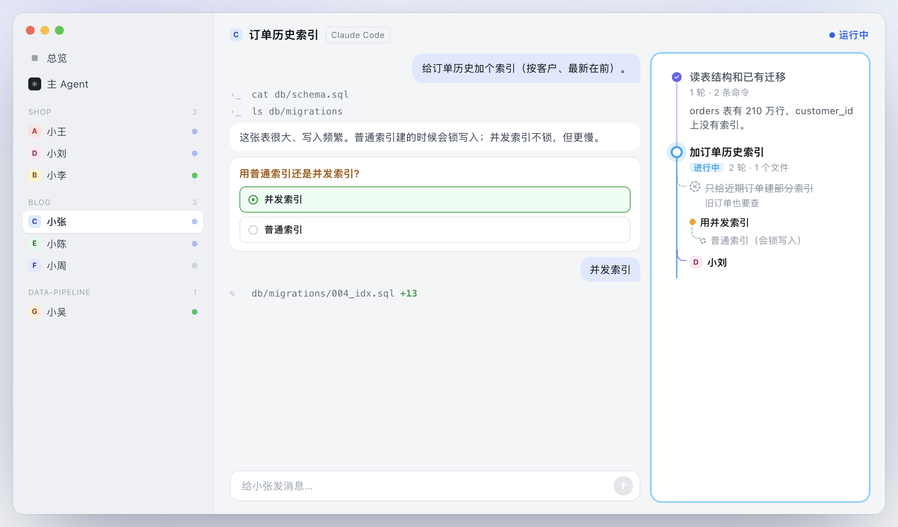

<p align="center">
  
</p>

<h1 align="center">Agent Workspace</h1>

<p align="center">
  <b>给你的编程 Agent 一间会议室。</b><br>
  Claude Code 与 Codex 并肩工作，一个主 Agent 统一调度，每一步都画在地图上。
</p>

<p align="center">
  <a href="https://github.com/Flitternie/agent-workspace/releases/latest"></a>
  
  
  <a href="LICENSE"></a>
</p>

<p align="center">
  <a href="https://github.com/Flitternie/agent-workspace/releases/latest"><b>下载</b></a> ·
  <a href="README.md">English</a> ·
  <a href="app/README.md">开发文档</a>
</p>

<p align="center">
  
</p>

Agent 可以并行，你的注意力不行。Agent Workspace 让每个 Agent 都坐到同一张桌前，把你说的话交给对的那一个，并记下工作是怎么一步步推进的。

## 总览

**所有 Agent 一目了然，没有被忽略的等待。**

- 每个 Agent 一张卡片：做了什么、在做什么、需要你做什么。
- 提问和权限请求连同改动内容一起留在卡片上，直到你处理。
- 在卡片上直接回复、批准或调整方向；每个 Agent 在自己的 git worktree 里工作。

## 主 Agent

**一个对话管住整个团队，打字或开口都行。**

<p align="center">
  
</p>

- 告诉主 Agent 你要什么，它会给对应的 Agent 交代清楚，必要时新建 Agent，或 fork 一个去试另一种方案。
- 问一句「大家进展怎么样？」，它按每个 Agent 当下在做的事回答。
- 麦克风可以像通话一样常开：「小张，迁移先停一下」直接交给小张，其余交给主 Agent。语音识别可以完全在本机完成。
- 它只负责协调，从不改代码，也不会自己批准任何权限请求。

## 工作地图（Work Map）

**工作是怎么推进的，替你画出来。**

<p align="center">
  
</p>

- **会话地图（Session Map）：** 把 Agent 的对话画成一棵任务树，带每个任务的结果、过程中的决定，以及 fork 出去尝试其他方案的分支。点一下就跳到对应位置。
- **团队地图（Team Map）：** 在主 Agent 旁边，每个 Agent 一条线：什么交给了谁、各自进展如何。对话太长会自动分章，地图随之更新。

## 内置的其他能力

- **旁支提问（`/btw`）：** 在 Agent 工作时问它关于这份工作的问题，它不用停下，也不会写进它的上下文。
- **Fork：** 从之前任意一条消息之前分叉，进到新的 worktree。
- **远端服务器：** Agent 可以通过 SSH 跑在你的服务器上，用那里的 CLI 和登录。
- **图片和文件：** 粘贴截图、用 `@` 引用文件，或者直接拖进来。
- **共享记忆：** 在 Claude Code、Codex 和你的多台机器之间同步，不覆盖你原有的文件。
- **接上已有会话：** 继续任何一个之前的 Claude Code 或 Codex 会话。

每项功能在两种 CLI 上都一样可用：

| | Claude Code | Codex |
|---|:---:|:---:|
| 总览卡片、卡片上处理权限 | ✓ | ✓ |
| 担任主 Agent | ✓ | ✓ |
| 会话地图与团队地图 | ✓ | ✓ |
| Fork | ✓ | ✓ |
| 旁支提问 | ✓ | ✓ |
| 图片与 `@` 文件 | ✓ | ✓ |
| 在 SSH 服务器上运行 | ✓ | ✓ |
| 接上已有会话 | ✓ | ✓ |

## 开始使用

1. **装好并登录 Claude Code 和/或 Codex。** Agent Workspace 直接使用它们和你现有的套餐，不需要额外的账号或 API key。
2. **下载**[最新版本](https://github.com/Flitternie/agent-workspace/releases/latest)：macOS（Apple Silicon）用 `.dmg`，Windows（x64，实验性）用 `.exe`。
3. **打开应用**，添加项目文件夹、新建 Agent；或者直接告诉主 Agent 你要做什么。

> [!NOTE]
> macOS 版还没有经过 Apple 公证，第一次打开请在「应用程序」里右键点击，选择「打开」。Windows 上如果 SmartScreen 提示，选择「更多信息 → 仍要运行」。

## 隐私

- **本地优先。** Agent 通过你机器或服务器上的 `claude` 和 `codex` CLI 运行，中间没有任何我们的服务器，工作区数据留在你的硬盘上。
- **按你的规则来。** 权限遵循各 CLI 自己的模式，可按 Agent 单独设置，从不绕过。应用不改你的 CLI 设置；共享记忆只在先备份后，写入它自己标记的那一段。
- **声音只属于你。** 用你自己的 OpenAI key，或用本机模型（SenseVoice、Whisper、Paraformer），音频不会发送到任何地方。

<details>
<summary><b>从源码运行</b></summary>

需要：macOS（已在 Apple Silicon 上测试）、Node 22，以及 `claude` 和/或 `codex` CLI。

```bash
npm run setup   # 依赖装在 app/node_modules
npm start       # 启动工作区
npm run demo    # 独立的演示，用模拟 Agent
```

脚本、测试、代码结构和发版流程见 [app/README.md](app/README.md)。

</details>

## 许可证

[AGPL-3.0](LICENSE)。欢迎提 issue 和 PR。
